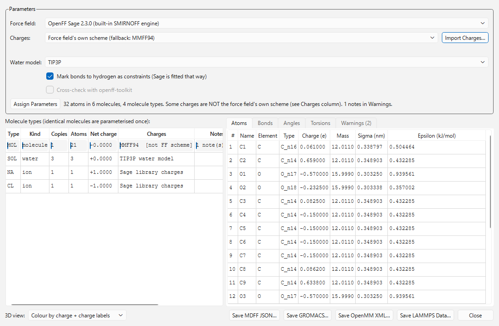
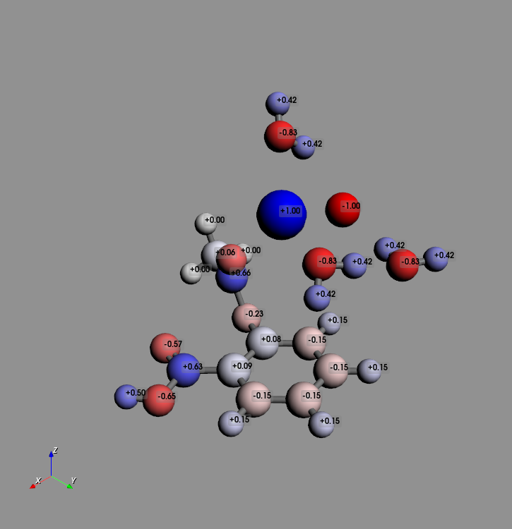
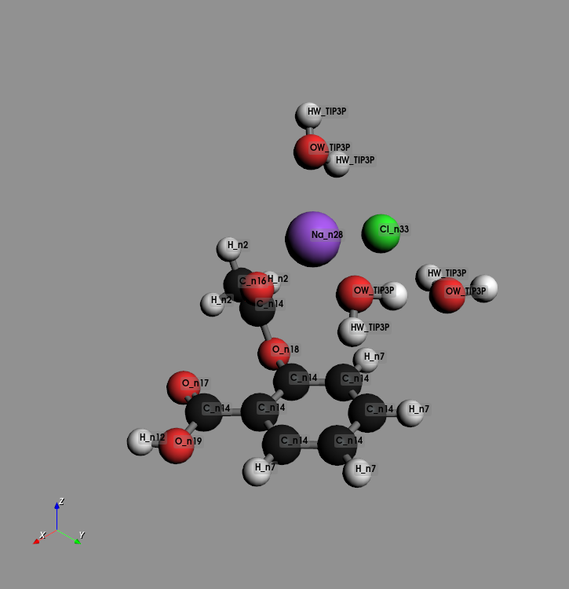
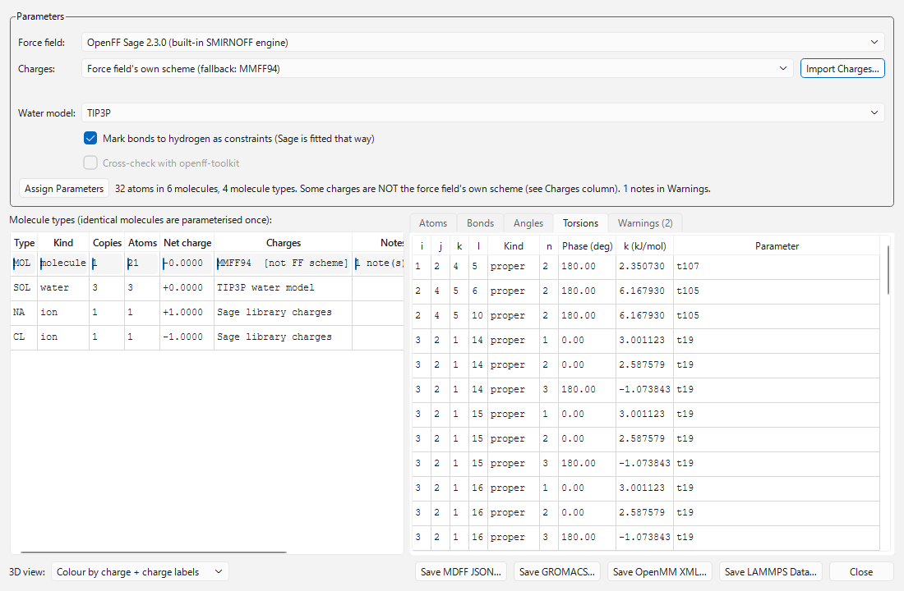

# MoleditPy Force Field Builder

[](https://github.com/HiroYokoyama/moleditpy_force_field_builder/actions/workflows/test.yml)
[](https://github.com/HiroYokoyama/python_molecular_editor)
[](https://github.com/HiroYokoyama/moleditpy_force_field_builder/tags)

A **MoleditPy** plugin that assigns molecular-mechanics force-field parameters to the
current structure and writes them out for MD: GROMACS `.top`/`.itp`, OpenMM ForceField XML,
LAMMPS data, and the neutral `moleditpy-mdff` JSON read by the MoleditPy MD generator plugins.

The default path needs nothing beyond MoleditPy itself: the bundled **OpenFF Sage 2.3.0**
force field is applied by a built-in SMIRNOFF engine on RDKit SMARTS matching. Proteins get
the bundled **Amber ff14SB**, residue by residue.

Repo: [https://github.com/HiroYokoyama/moleditpy_force_field_builder](https://github.com/HiroYokoyama/moleditpy_force_field_builder)



---

## Key Features

- **OpenFF Sage 2.3.0 without extra packages**: bonds, angles, proper and improper torsions
  and van der Waals parameters are assigned from the SMIRNOFF `.offxml` with RDKit SMARTS
  matching (MDL aromaticity, last match wins per term, as in the OpenFF toolkit).
- **Cross-check with the OpenFF toolkit**: when `openff-toolkit` is installed, the assignment
  is compared term by term with the toolkit's labels and any difference is listed under Warnings.
- **Optional force fields**: GAFF / GAFF2 through `acpype` (antechamber), and GAFF 2.11 through
  `openmmforcefields`, when those are installed.
- **Charges**: the force field's own scheme (Sage: OpenFF NAGL AM1-BCC charges when
  `openff-nagl` is installed, otherwise AM1-BCC from AmberTools `sqm`), Gasteiger, MMFF94,
  GFN2-xTB (`xtb`), or charges imported from a QM result: ORCA, Gaussian, Q-Chem, Psi4 or xtb
  output, PySCF Calculator JSON, xtb `--json` output, mol2, or a plain list. A QM output may
  hold several charge sets (RESP, CHELPG / Merz-Kollman ESP, MBIS, CM5, Hirshfeld, NPA,
  Loewdin, APT, Mulliken); the importer then asks which to use, with ESP-fitted charges
  first. Charges that are **not** the force field's own scheme are marked `[not FF scheme]` in
  the molecule table and in the output.
- **RESP charges with AmberTools**: import a Gaussian job run with
  `Pop=MK IOp(6/33=2)` (the ESP points are printed) and, when AmberTools is on the PATH,
  antechamber fits two-stage RESP charges to them (`-fi gout -c resp`). They are offered
  first, before the unrestrained ESP fit from the same file. If the fit fails, the reason is
  shown and the other charge sets are still offered. Checked against antechamber run by
  hand with AmberTools 24.8; the `resp` program of the conda-forge AmberTools 26.0 build
  crashed in our test, so use 24.x if no RESP charges appear.
- **QM charges for one molecule**: a charge file may cover the whole system or a single
  molecule. One molecule's charges go to every molecule with the same atom count and element
  order (for example a ligand computed alone, then solvated); the other molecules use Auto.
- **Equivalent atoms averaged**: imported and xTB charges are averaged over
  symmetry-equivalent atoms (methyl hydrogens, carboxylate or nitro oxygens; resonance forms
  count as one), keeping the total charge. It can be switched off.
- **Proteins with Amber ff14SB**: a molecule made of standard amino-acid residues is
  parameterised with ff14SB from its residue templates, including the N- and C-terminal
  forms, HIE / HID / HIP, ASH, GLH, LYN, CYX / CYM and the ACE / NME caps. Templates are
  matched on the bond graph, so hydrogen names do not matter and the protonation state is
  read from the hydrogens that are present. See [Proteins](#proteins).
- **Water and ions from tables**: TIP3P, SPC/E and OPC3 water; Sage library charges and
  Lennard-Jones parameters for monatomic ions.
- **Identical molecules parameterised once**: the system is split into molecules, identical
  ones (same graph and atom order) share one molecule type, and copies are counted.
- **Interleaved atoms are fixed on request**: MoleditPy's 3D conversion puts every hydrogen
  after all heavy atoms, which mixes the molecules of a multi-molecule system. The plugin
  offers to reorder the atoms molecule by molecule (coordinates unchanged, undoable) before
  it assigns parameters.
- **See it in 3D**: colour the atoms by charge (red negative, blue positive), show charge
  labels, or show atom-type labels in MoleditPy's 3D view.
- **Manual edits**: charges, sigma, epsilon (applied across the atom type) and
  every bond, angle and torsion parameter can be edited in the tables. Edits are marked as
  hand-made in the warnings.
- **Missing-parameter warnings**: terms with no Sage match fall back to UFF-derived values
  (bonds, angles, van der Waals) and are listed; missing proper torsions are reported.
- **Saved with the project**: the settings and the assigned (and edited) parameters are
  stored in the MoleditPy project and restored when it is reopened.




---

## Installation

Install it from MoleditPy's Plugin Installer, or download the release ZIP and extract the
`force_field_builder` folder into `~/.moleditpy/plugins/` (`%USERPROFILE%\.moleditpy\plugins\`
on Windows). Restart MoleditPy; the plugin appears under **Tools > Force Field Builder...**.

Required: MoleditPy 5.x (which brings RDKit, numpy, PySide6 and PyVista). Optional, each
adding a feature when present:

| Package / program | Adds |
|---|---|
| `openff-toolkit` | cross-check of the Sage assignment |
| `openff-nagl` | Sage's own AM1-BCC (NAGL) charges |
| AmberTools (`antechamber`, `sqm`) | AM1-BCC charges |
| AmberTools (`antechamber`, `espgen`, `respgen`, `resp`) | RESP charges from a Gaussian ESP job |
| `acpype` + AmberTools | GAFF / GAFF2 |
| `openmmforcefields` + `openff-toolkit` | GAFF 2.11 via openmmforcefields |
| `xtb` | GFN2-xTB charges |

## Usage

1. Build or open the system in MoleditPy and convert it to 3D (hydrogens must be explicit).
2. Open **Tools > Force Field Builder...**, choose the force field, charge method and
   water model, and press **Assign Parameters**.
3. Check the molecule types, the per-atom table and the Warnings tab; edit values if needed.
4. Save as MDFF JSON, GROMACS, OpenMM XML or LAMMPS data.



## Proteins

A protein, together with its water and ions, is parameterised in one build:

1. Open the PDB file in MoleditPy and prepare it with **MD System Builder > Protein**
   ([MD System Builder](https://github.com/HiroYokoyama/moleditpy_md_system_builder)). That
   adds the hydrogens for pH 7, the disulfide bonds and the missing heavy atoms, and sets the
   formal charges. A PDB file that already has every hydrogen and the S-S bonds (as
   `CONECT` records) can be used directly.
2. Solvate it, then press **Assign Parameters** here.

Every block of amino-acid residues becomes one molecule type named `PROTEIN`, with the charges
of ff14SB itself; the charge method chosen in the dialog applies to the other molecules only.
The molecule type keeps the PDB atom names, and its `force_field` is
`Amber ff14SB (proteins)`. Ligands, water and ions in the same system get Sage and the water
model as usual. A cysteine whose sulfur has neither a hydrogen nor a disulfide bond is an
error rather than a guess.

ff14SB has no CMAP and no virtual sites, so the result is complete in every output format.
The parameters were checked against AmberTools 25: on crambin and protein G (2IGD), a GROMACS
run of our topology and of the tleap + ParmEd one agree within 0.003 kJ/mol for every term,
and on the test peptide the energy terms match sander to 0.002 kcal/mol
(`tests/test_amber.py`).

## Output formats

- **GROMACS**: `<name>.top` with `[ defaults ] 1 2 yes 0.5 0.833333`, the shared
  `[ atomtypes ]` and `[ system ]` / `[ molecules ]`, and one `<name>_<TYPE>.itp` per molecule
  type. Propers are function 9, impropers function 4, 1-4 pairs are listed. Water gets
  `[ settles ]` (or `[ constraints ]`) inside `#ifndef FLEXIBLE`.
- **OpenMM ForceField XML**: one atom type per atom, so every bonded term is exact.
  SMIRNOFF-style impropers use `ordering="smirnoff"`. Load it together with a PDB whose
  residues follow the same molecule order. OpenMM's `rigidWater` recognises water only
  when the residue is named `HOH`.
- **LAMMPS data**: `units real`, `atom_style full`, harmonic bonds and angles, and all
  torsions (impropers included) as `dihedral_style fourier`. The box comes from the
  molecule's `moleditpy_cell` (triclinic included) or a padded bounding box. Pair
  coefficients are written per atom type; use `pair_style lj/cut/coul/long` with
  `special_bonds lj 0 0 0.5 coul 0 0 0.833333` and `pair_modify mix arithmetic`.

## The `moleditpy-mdff` JSON format (version 1)

The hand-off file between the Force Field Builder and the MoleditPy GROMACS, OpenMM and
LAMMPS input generators (`*.mdff.json`). Units are GROMACS units: **nm, kJ/mol, degrees,
elementary charge, amu**.

```json
{
  "format": "moleditpy-mdff",
  "version": 1,
  "source": "MoleditPy Force Field Builder 0.1.0: OpenFF Sage 2.3.0 (built-in SMIRNOFF engine)",
  "combination_rule": 2,
  "fudge_lj": 0.5,
  "fudge_qq": 0.833333,
  "molecule_types": [ ... ],
  "system": [ {"type": "MOL", "count": 1, "atom_offset": 0},
              {"type": "SOL", "count": 3, "atom_offset": 9} ]
}
```

`combination_rule` 2 is Lorentz-Berthelot (sigma arithmetic, epsilon geometric mean).
`system` lists the molecule types in the atom order of the MoleditPy molecule;
`atom_offset` is the 0-based index of the first atom of the first copy, and copies follow
each other contiguously.

Each entry of `molecule_types`:

| Key | Content |
|---|---|
| `name` | molecule type name (`MOL`, `SOL`, `NA`, ...) |
| `atoms` | `[{name, element, type, charge, mass, sigma, epsilon}]`; Lennard-Jones 12-6 in sigma/epsilon form |
| `bonds` | `[{i, j, r0, k}]`, harmonic: E = k/2 (r - r0)^2 |
| `angles` | `[{i, j, k_atom, theta0, k}]`, harmonic in the angle: E = k/2 (theta - theta0)^2, k in kJ/mol/rad^2, theta0 in degrees, `j` the centre |
| `torsions` | `[{i, j, k_atom, l, periodicity, phase, k, improper}]`, periodic: E = k (1 + cos(n phi - phase)), one entry per Fourier term |
| `exclusions_nrexcl` | bonded exclusions (3; 2 for water) |
| `constraints` | optional `[{i, j, r0}]`: bonds that should be constrained (bonds to hydrogen for Sage). The bonds stay listed in `bonds`, so a reader that ignores constraints still has a complete topology |
| `settles` | optional `{i, doh, dhh}` for rigid 3-site water: oxygen index, O-H and H-H distances |

Atom indices `i`, `j`, `k_atom`, `l` are 0-based within the molecule type.

**Impropers**: an improper torsion has `improper: true` and lists the **central atom first**
(`i`). SMIRNOFF impropers are written as the three trefoil permutations (c,a,b,d), (c,b,d,a),
(c,d,a,b), each carrying one third of the force constant, so a reader can apply every
entry as an ordinary periodic torsion. GAFF impropers from acpype are one entry each, in
the order acpype wrote them.

Extra keys a reader may ignore: `id` on terms (the SMIRNOFF parameter id), and on molecule
types `smiles`, `force_field`, `charge_method` and `charges_from_force_field` (false when the
charges are not the force field's own scheme).

Example files: [`examples/water_tip3p.mdff.json`](examples/water_tip3p.mdff.json),
[`examples/nacl_in_water.mdff.json`](examples/nacl_in_water.mdff.json),
[`examples/ethanol_in_water.mdff.json`](examples/ethanol_in_water.mdff.json), and the
GROMACS, OpenMM and LAMMPS files generated from the ethanol system in
[`examples/ethanol_in_water/`](examples/ethanol_in_water). `examples/make_examples.py`
regenerates them.

## Notes and limits

- **OPC**: OPC is a 4-site model with a virtual site, which version 1 of the mdff format
  cannot describe; the 3-site **OPC3** is offered instead.
- Sage is fitted with bonds to hydrogen constrained; keep "Mark bonds to hydrogen as
  constraints" on for production runs.
- Validation: the built-in engine gives the same parameter ids as `openff-toolkit` 0.19 on
  the 25 test molecules in `tests/test_external.py`, and the bonded energies of the OpenMM
  XML match OpenFF Interchange's System to 1e-9 kJ/mol.
- Virtual sites, polarisable force fields, CMAP and Urey-Bradley terms are not supported.
  Protein force fields with CMAP (ff19SB, CHARMM36m) are therefore not offered.
- Proteins: only the standard residues of ff14SB. Modified residues, nucleic acids and
  metal centres are not parameterised.

## Development

```bash
pip install pytest numpy rdkit PySide6-Essentials
QT_QPA_PLATFORM=offscreen python -m pytest tests -q
ruff check . && ruff format --check .
```

Tests that need `openff-toolkit` or `openmm` are skipped when those are absent.

## License

The plugin is licensed under the GNU Lesser General Public License v3.0 or later
(`LGPL-3.0-or-later`); see [LICENSE](LICENSE), [COPYING](COPYING) and
[LICENSING.md](LICENSING.md).

The bundled force field `force_field_builder/data/openff-2.3.0.offxml` is from the
[Open Force Field Initiative](https://openforcefield.org/)
([openff-forcefields](https://github.com/openforcefield/openff-forcefields)) and is
distributed under the Creative Commons Attribution 4.0 International license
(`force_field_builder/data/LICENSE-openff-forcefields.txt`). Please cite the OpenFF Sage
force field when you publish results obtained with it.

`force_field_builder/data/amber_ff14sb.json` holds the Amber ff14SB parameters and residue
templates converted from the AmberTools files `parm10.dat`, `frcmod.ff14SB` and the
`amino12` libraries, which their authors placed in the public domain
(`force_field_builder/data/LICENSE-amber-ff14sb.txt`). Please cite Maier et al., *J. Chem.
Theory Comput.* 2015, 11, 3696-3713, when you publish results obtained with it.
